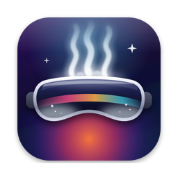

# MacVapoR

Play Windows PC VR games from Steam on a Mac, shown on an Apple Vision Pro. The games run
under [NotProton](https://github.com/NotProtonNot/NotProton)'s CrossOver runner; MacVapoR
gives them an OpenXR runtime, alvrxr, that streams each frame to the
[ALVR](https://apps.apple.com/app/alvr/id6479728026) app on the Vision Pro and brings head,
PS VR2 Sense controller and button input back. No PC and no SteamVR.

Game audio streams to the headset with the video. OpenXR games (Beat Saber) run directly; OpenVR (SteamVR) games such as The Lab run through
[OpenComposite](https://gitlab.com/znixian/OpenOVR), which MacVapoR downloads for you.

## What you need

- An Apple silicon Mac with macOS 15 or later. Tested so far on macOS 27, M4 Max.
- NotProton with its CrossOver runner, and the games installed through Steam under it.
- An Apple Vision Pro with ALVR from the App Store, on the same network as the Mac, and
  PS VR2 Sense controllers paired to the Vision Pro.

Tested: Beat Saber and The Lab, both with D3D11. Other D3D11 games are likely to work;
Vulkan and D3D12 games are not supported yet.

## Install

1. Download the DMG from the [releases](https://github.com/fayep/MacVapoR/releases), open
   it, and drag MacVapoR to Applications. It is signed and notarized.
2. Open MacVapoR and click **Install**: the runtime goes into
   `~/Library/Application Support/MacVapoR`.
3. macOS asks whether **MacVapoR Audio** may record audio: allow it. It sends each game's sound to
   the headset, and keeps the game quiet on the Mac. MacVapoR shows whether it is allowed.

## Set a game up

1. Launch the game once through NotProton, so it has a Wine prefix, and quit it.
2. In NotProton, set the game's graphics to **DXMT**.
3. In MacVapoR, find the game under **Games**, check the executable, and click **Set Up**.
   For an OpenVR game, click **Download OpenComposite** first.
4. Wake the controllers, open ALVR on the Vision Pro, and launch the game.
5. The first time, the headset appears under **Headsets**: trust it, then restart the game.

Playing seated? Under **Headsets**, choose **Seated: fixed eye height**, so standing games put your eyes
at that height instead of your real one.

**Undo** puts a game back as it was. The runtime's log is at `~/Library/Logs/alvrxr.log`.

## Known issues

- If visionOS takes focus away (Siri, a screenshot, the Mac's screen), the controllers'
  buttons stop working until ALVR is reopened. A fix for the ALVR app is waiting upstream.
- The controllers must be awake when ALVR connects, or their buttons may not come through.
- Loading screens hold the last frame; there is no compositor scene in between.
- The Lab's Secret Shop runs at about 1 fps: its game code is slow under the x86 emulation of
  NotProton's runner. The VR pipeline is not the cause; the hub and Beat Saber run at full rate.
- ALVR's "Stream refresh rate" setting limits the frame rate; set it to 120 Hz.

# alvrxr, the runtime

## Build and use

    ./build.sh                                  # needs ~/Source/ALVR-20.14.1 and a built OpenXR-SDK-Source
    XR_RUNTIME_JSON=$PWD/out/alvrxr.json some_openxr_app

The runtime starts ALVR's server_core inside the app's process, with its session and logs in
`~/Library/Application Support/alvrxr` (copied from the spike's on first run, so a headset
trusted there is trusted here). Runtime log: `~/Library/Logs/alvrxr.log`.

`ALVRXR_DUMP=file.h265` composes and encodes without a headset and writes the stream to the
file, for a look with a desktop decoder.

## What is there

- Instance and system, the session state machine, VIEW/LOCAL/STAGE spaces, paths.
- Vulkan swapchains (`XR_KHR_vulkan_enable`, `enable2`): images are made on the app's own
  VkDevice and MoltenVK exports the MTLTexture behind each (`VK_EXT_metal_objects`), so the
  Metal compositor samples them, on the MTLCommandQueue behind the app's VkQueue. Vulkan is
  called through the library that owns the app's handles: the loader for a native app,
  MoltenVK itself under CrossOver, whose Wine loads it without a loader. There Wine only lets a
  Windows app enable extensions it can wrap, so VK_EXT_metal_objects is out of reach and the
  textures and queue come from MoltenVK's own exports (vkGetMTLTextureMVK and friends).
- Metal swapchains (`XR_KHR_metal_enable`); the first stereo projection layer is composed
  straight into ALVR's foveated stream layout on the app's own queue, then HEVC-encoded.
- Each frame is tied to an ALVR tracking sample: its poses come from that sample and the
  encoded frame carries its timestamp, so the client reprojects correctly.
- Actions for the Touch (and simple) controller profiles: ALVR presents Sense controllers as
  Touch controllers and names inputs by their OpenXR paths, so bindings resolve directly.
  Pose action spaces and haptics.

## Not yet

- `hello_xr -g Vulkan` behind the Homebrew loader needs `VK_DRIVER_FILES` pointing at a copy of
  MoltenVK's manifest without `is_portability_driver`, since that app does not ask for
  portability drivers. (`-g Vulkan2` is fine: the runtime creates the instance and asks.)
- The aim pose is the grip pose; the offset is not measured yet.
- Quad and other non-projection layers are ignored; depth is accepted and ignored.
- Velocities are not reported.

## Releases

`macvapor/make-release.sh` builds the runtime, NotProton's wineopenxr and the MacVapoR app for
macOS 15, signs them with a Developer ID, notarizes and staples the app and the DMG.
`tools/notproton-vr-setup.sh` is the per-game setup MacVapoR runs, usable on its own.

MIT licence; the bundled components keep their own, see `macvapor/LICENSES/NOTICE.txt`.
